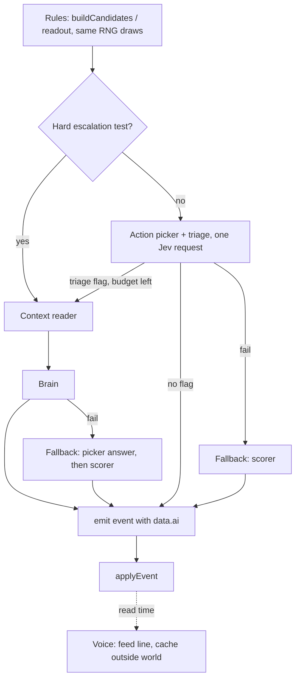

# AI brain

**Status: Open.** Design and research note for the Lead and Micah. Nothing in this note is in the tree. No account was created, no API key was used, and no model was called. Choosing a vendor, signing up, and paying stay Micah's call.

Micah's brief: a "nervous system and brain" for AI characters. Small, cheap models (Jev or an alternative) take routine character decisions. A big "brain" model (DeepSeek or similar) is asked only for big decisions. This note says which decisions are which, how the sim stays deterministic and replayable, what the candidates cost per 1200-tick run, and what the smallest pilot is.

It builds on [small agents](../research/small-agents.md) (`baee32a`), which measured the action stream on seed 1847 at `e87ba91` and found where a model choice can sit under the M33 replay rule. That note's mechanics still hold and are not repeated in full here.

## Checked on

`origin/main` at `f451793` (merge of PR #125). Node v24.22.0, ICU 78.3 (the Node 24 release available to this box; the fixture was generated on v24.21.0). `npm test` passed, 459 tests, 0 failed. A local harness outside the repository ran `createPrototypeWorld(seed)` and 1,200 calls to `runTick`, seeds 1847, 2718, and 4096, no player commands. `git status` was clean afterwards. The 72-tick hashes matched the committed fixture.

| Seed | Tick 72 hash (events) | Tick 1200 hash | Events |
| --- | --- | --- | ---: |
| 1847 | `86507558` (8426) | `7314d632` | 163059 |
| 2718 | `c6268c39` (8335) | `b7015fce` | 165135 |
| 4096 | `d62ab7f9` (8266) | `7f0f865b` | 168755 |

This is the tree, batch 1 included. The batch 2 stack is not built, so it has no contract events. Contract counts below are copied from the cancellation-at-10 table in [contract fulfilment](contract-fulfilment.md) and are labelled as such. Negotiation is not built either.

## Jev, verified

Jev is TypeSafe AI's model, as `baee32a` said. Checked on 2026-10-19:

- [Introducing System One Models & Jev](https://typesafe.ai/blog/introducing-system-one-models-and-jev) (Diogo Almeida, founder, TypeSafe, Sep 15, 2026). Jev is the first "System One" model. It returns typed, probabilistic decisions instead of generated text. Input $0.042 per million tokens, output free. End-to-end response time 70–500 ms. Choice cardinality up to 255. Early access.
- [TypeSafe models](https://docs.typesafe.ai/models). Current IDs `jev-1.14.0` (available from October 14, 2026, alias `jev-preview`) and `jev-1.13.0` (alias `jev-latest`). Both $0.042 per million input tokens, output free. 64k per-request and 32k per-question context. Text only. Endpoint `POST /v1/systemone`. Rate limits are now "set per organization" in the console; the 80 requests per second figure `baee32a` quoted is no longer on that page and is not used here. The page says an alias "moves when a new release ships" and recommends sending a versioned ID once thresholds are tuned.

## Correction, 2026-10-26

Two counts were wrong in the first version of this note, found while writing [AI pilot A](ai-pilot-a.md) on `f1a0db3`:

1. The tax step's 22 / 25 / 26 counted **both factions**. Free Tide alone steps 15 / 22 / 25 times on seeds 1847 / 2718 / 4096. World Government, whose holder is the human Mara Vane, steps 7 / 3 / 1 times and stays on the scorer.
2. A model may step where the scorer holds, so the pilot asks at **every 24-tick clock point**: 45 / 45 / 42 calls per run, not only where the scorer steps.

Updated from those: the big-tier totals (332 / 376 / 364), the brain cost tables (376 calls), the pilot cost ($0.19 peak, $0.095 off-peak), step B ($0.0028), the every-role total ($2.02), and defaults 18 and 19. Token sizes are unchanged and still assumed.

## 1. Decision points

### Escalation rule

A decision goes to the brain when it does at least one of these:

1. **Changes who holds a port**, or puts a port's holding at stake (secession, raid, claim).
2. **Sets a faction-wide number** (the holder's tax step).
3. **Changes a person's allegiance or freedom** (desertion, captivity terms, ransom).
4. **Breaks a promise by choice** (a contract breach whose cause is `choice` / `better-motive`, or abandoning a negotiated term).

Everything else is the nervous system: the small-model roles in section 3a, or the rules when they are off. Triage can add an escalation but never removes one that a hard test makes. A routine action decision is promoted to the brain only if its legal list contains `raid` or `claim-settlement`; the brain then picks from the whole list, so a raid-capable character can still decide to rest.

The rule names event types, not scores, so it can be checked from the log. It does not depend on the model's own confidence. Confidence-based escalation (a small model that is unsure hands up) is a later option; it makes the routing depend on a model output, which is harder to replay and audit.

### Table

Counts per 1200-tick run, seeds 1847 / 2718 / 4096. "Tree" means the harness above on `f451793`. "Docs" means copied from the named note.

| Decision point | Where it is today | Tier | 1847 | 2718 | 4096 | Source |
| --- | --- | --- | ---: | ---: | ---: | --- |
| Action, ashore (`decision-made`), no raid or claim on the list | `buildCandidates`, `candidates[0]` | Small | 26,727 | 27,103 | 27,686 | Tree: all `decision-made` minus the row below |
| …of which `rest` / `work` | same | Small | 11,379 / 6,172 | 10,960 / 6,899 | 11,910 / 6,691 | Tree |
| …of which `travel` (movement) | same | Small | 2,180 | 2,218 | 2,024 | Tree |
| …of which `buy-provisions` / `trade-local` (buying) | same | Small | 1,921 / 3,243 | 2,089 / 3,225 | 2,298 / 3,041 | Tree |
| …of which `recruit` (recruitment) | same | Small | 1,928 | 1,863 | 1,900 | Tree |
| Action whose legal shortlist holds `raid` or `claim-settlement` | same | **Big** | 214 | 269 | 247 | Tree. Chosen: raid 78 / 74 / 48, claim 40 / 44 / 21 |
| Free Tide holder's tax step, asked at every 24-tick clock point | `autonomousTaxStep` (`src/sim/tax-rate.ts`), `chooseAutonomousTaxRates` | **Big** | 45 | 45 | 42 | Tree, [AI pilot A](ai-pilot-a.md). Free Tide's actual steps are 15 / 22 / 25 |
| World Government holder's tax step (`tax-rate-set`) | same | Rules | 7 | 3 | 1 | Tree, [AI pilot A](ai-pilot-a.md). Mara Vane is the human holder; headless runs step her on the scorer |
| Secession (`secession-declared`, autonomous) | `src/sim/secession.ts`, engine | **Big** | 5 | 5 | 2 | Tree |
| Desertion (`character-deserted`) | `resolveMorningDesertion` | **Big** | 3 | 1 | 6 | Tree. Desertions, not rolls; a roll that fails emits nothing, so the number of times the 12-morning streak was reached is not countable from the log |
| Captivity: one captor-side terms decision per capture (`character-captured`) | combat and captivity | **Big** | 16 | 11 | 6 | Tree. Releases 15 / 8 / 6. Negotiation is unbuilt; today the ransom is paid without bargaining ([negotiation](negotiation.md)) |
| Negotiation offers (ransom, contract, pact, tribute) | not built | **Big** | — | — | — | [Negotiation](negotiation.md) is a brief; no count exists |
| Contract offer answered (accept or refuse) | `assessSupplyContract`, batch 2 walk | Small | 320 | 186 | 430 | Docs: [contract fulfilment](contract-fulfilment.md), cancellation at 10 |
| Contract breach by choice (`choice` / `better-motive`) | batch 2 haul | **Big** | 49 | 45 | 61 | Docs: same table. `deadline-infeasible` (146 / 46 / 157) is a feasibility outcome, not a choice, and stays on the rules |
| Plan review (`plan-reconsidered`) | `reviewPlan` | Rules | 16,003 | 16,262 | 18,411 | Tree. Most are the provisions-reserve trigger (`baee32a`); not sent to any model in this design |
| Standing order accept / refuse | `assessStandingOrder` | Small | 20 | 20 | 20 | Tree (14 + 6, 14 + 6, 16 + 4) |
| Autonomous retreat (`battle-retreated`) | `autonomousShouldRetreat` | Rules | 13 | 13 | 9 | Tree. Only true results are events, so the number of checks is not countable |

Totals per run, each column summed from the table:

- **Small tier:** 26,727 + 320 + 20 = 27,067; 27,103 + 186 + 20 = 27,309; 27,686 + 430 + 20 = 28,136.
- **Big tier:** 214 + 45 + 5 + 3 + 16 + 49 = 332; 269 + 45 + 5 + 1 + 11 + 45 = 376; 247 + 42 + 2 + 6 + 6 + 61 = 364.

The brain sees about 1.4% of the decisions (376 / (376 + 27,309) on 2718). Pax Ash (`character-14`) alone made 1,010 / 939 / 932 action decisions.

## 2. Determinism and replay

The M33 rule governs everything here: replay goes only through `applyEvent`, extra randomness uses side RNG streams, and `stateHash` covers world state only, not the event log.

1. **The call sits in `runTick`, before `emit`.** The model's answer is written onto the decision's own event (`decision-made.data.goal` and `data.chosen`, `tax-rate-set.data.taxRate`, `secession-declared`, and so on). The effect events that follow carry absolute values, as they do today. `WorldStore.recover` replays those events through `applyEvent` and never calls a provider. A provider inside `applyEvent` would make every recovery a new decision.
2. **No new event type for the choice.** The default arm of `applyEvent` throws on an unknown type. Model metadata rides on the existing event's `data`.
3. **The scorer still runs and still draws.** `buildCandidates`, the tax readout, and the secession readout are computed exactly as now and consume the same main-stream draws. The model replaces the index, not the draw. Otherwise later ticks diverge even when the model agrees.
4. **Seeded fallback.** On flag off, no provider, timeout, error, or an answer that is not in the legal set: emit the scorer's choice (`candidates[0]`, or the readout's step). A fallback writes the same fields the scorer writes, so the world, and therefore the hash, is unchanged. The reason goes on `data.ai` (below); `applyEvent` does not read it.
5. **AI off is byte-identical.** With the flag off, no field is added to any event, so both `stateHash` and the event bodies match today. The golden fixture (`86507558` / `c6268c39` / `d62ab7f9`) and the 600-event split recovery must pass unchanged. With the flag on and every call falling back, `stateHash` and event counts must match flag-off; event bodies differ only by `data.ai`.
6. **Any model-only randomness uses a side stream.** If a choice is sampled from a model's probabilities (Jev returns a probability per option), the draw comes from a side stream keyed by seed, tick, and actor, so the main `rngState` is untouched.
7. **What gets recorded** on `data.ai`: `tier` (`small` or `big`), `provider`, the versioned `model` ID the response names (never an alias such as `jev-latest`), `promptVersion` (a hash of the prompt template), `inputHash` (sha256 of the canonical request), `outcome` (`model`, `fallback-timeout`, `fallback-error`, `fallback-illegal`, `cache`), and `latencyMs`. The answer itself is the event's normal field.
8. **Pinning.** A run's config names one model ID and one prompt version per tier. Changing either is a new run, not a replay. A run log records both on tick 0, so a reader knows which brain made which world.
9. **Caching.** An optional cache keyed by `inputHash` stores answers on disk outside the world. It saves cost on re-runs of the same seed and config. It is never needed for replay, because replay reads the events. A cache hit is logged as `outcome: cache`.
10. **Wall-clock independence.** A timeout produces a fallback, and the fallback is recorded, so a slow network changes `data.ai.outcome` on that run. Replay of that log is still exact. Two live runs with the same seed can still differ if one timed out; that is a property of live AI, and it is why the flag stays off in the fixture.

`runTick` is synchronous today. A live call needs either an awaited provider (a change to the tick loop's signature) or a pre-computed answer file. The pilot below uses the awaited form for one decision type only.

## 3. Candidate models

### Token assumptions

- **Small call, input: 124.62 tokens.** Measured bytes from `baee32a` (mean 498.50 bytes per action decision: actor, archetype, plan, goal, six options) divided by 4. A byte-per-token stand-in, not a tokenizer count.
- **Small call, output: 16 tokens.** Assumption from `baee32a`: a short JSON choice, no reasoning. Jev does not charge output.
- **Big call, input: 2,000 tokens. Output: 400 tokens.** **Assumption, not measured.** Room for the character, the faction's ports, treasury, rates, recent news, and the legal options, plus a short stated reason. A thinking-mode model can spend far more output; that is not estimated.
- **Calls:** the highest seed in the table, so the figures are an upper estimate across the three seeds: 28,136 small calls (4096) and 376 big calls (2718).

Small run tokens: 28,136 × 124.62 = 3,506,308 input; 28,136 × 16 = 450,176 output. Big run tokens: 376 × 2,000 = 752,000 input; 376 × 400 = 150,400 output.

### Small tier (nervous system)

Cost = input tokens × input price + output tokens × output price, per million, standard tier, list prices. Estimates.

| Model | Runs where | Price in / out per M | Cost per run (estimate) | Latency | Source |
| --- | --- | --- | --- | --- | --- |
| Jev `jev-1.14.0` / `jev-1.13.0` | API only (TypeSafe) | $0.042 / free | 3.506308 × 0.042 = **$0.147** | 70–500 ms per call (vendor). Serial over 28,136 calls: 33–234 min, estimate | [docs.typesafe.ai/models](https://docs.typesafe.ai/models), [launch post](https://typesafe.ai/blog/introducing-system-one-models-and-jev) |
| OpenAI `gpt-5-nano` | API only | $0.05 / $0.40 | 0.1753 + 0.1801 = **$0.355** | Not published | [OpenAI pricing](https://developers.openai.com/api/docs/pricing) |
| OpenAI `gpt-6-luna` | API only | $0.10 / $0.50 | 0.3506 + 0.2251 = **$0.576** | Not published | Same page |
| Groq `openai/gpt-oss-20b` | API (open weights also exist) | $0.075 / $0.30 | 0.2630 + 0.1351 = **$0.398** | 1,000 tokens/s listed; decode-only estimate 16 ms per call, time to first token not published | [Groq models](https://console.groq.com/docs/models) |
| `deepseek-flash` (DeepSeek-V4.1-Flash), non-thinking | API | $0.30 / $1.20 peak; $0.15 / $0.60 off-peak (cache miss) | Peak 1.0519 + 0.5402 = **$1.59**; off-peak **$0.80** | Not published | [DeepSeek pricing](https://api-docs.deepseek.com/quick_start/pricing) |
| `qwen3:0.6b` / `qwen3:1.7b` | Local, Ollama (523 MB / 1.4 GB) | $0 | **$0** API; machine time only | Carried from `baee32a` (lintware tool-calling benchmark, laptop CPU): 3,410 ms and 10,665 ms per prompt. Serial over 28,136 calls: about 26.6 h and 83.3 h, estimate | [Ollama qwen3](https://ollama.com/library/qwen3); benchmark as cited in [small agents](../research/small-agents.md), not re-fetched |

Jev is the cheapest API and its Choice primitive matches "pick one legal row" directly. Its latency, not its price, is the constraint: a serial call per decision adds minutes to a 1.6-second run. The small tier is only worth turning on once calls are batched per tick (Jev's docs describe many questions against one `state` in a single request) or run ahead of the tick.

### Big tier (brain)

| Model | Runs where | Price in / out per M | Cost per run (estimate, 376 calls) | Latency | Source |
| --- | --- | --- | --- | --- | --- |
| `deepseek-v4-pro` | API | $1.32 / $3.96 peak; $0.66 / $1.98 off-peak (cache miss) | Peak 0.9926 + 0.5956 = **$1.59**; off-peak **$0.79** | Not published | [DeepSeek pricing](https://api-docs.deepseek.com/quick_start/pricing) |
| `deepseek-flash`, thinking mode | API | $0.30 / $1.20 peak | 0.2256 + 0.1805 = **$0.41**, before thinking tokens | Not published | Same page |
| OpenAI `gpt-5.6-terra` | API | $2.00 / $12.00 | 1.504 + 1.805 = **$3.31** | Not published | [OpenAI pricing](https://developers.openai.com/api/docs/pricing) |
| OpenAI `gpt-6-sol` | API | $2.00 / $10.00 | 1.504 + 1.504 = **$3.01** | Not published | Same page |
| `qwen3:30b` | Local, Ollama (19 GB) | $0 | **$0** API | Not measured; no public figure on this machine class was found | [Ollama qwen3](https://ollama.com/library/qwen3) |

DeepSeek peak hours are 01:00–04:00 and 06:00–10:00 UTC on weekdays (18:00–21:00 and 23:00–03:00 PT); off-peak is half price. Whether DeepSeek V4 weights can run locally was not checked and is not assumed. The TypeSafe launch post reports end-to-end response times of 3 to 329 seconds for frontier LLMs in general; that is the vendor's claim about competitors, not a DeepSeek figure, and it is a reason the brain should only see a few hundred calls.

**Both tiers, per run, estimate:** Jev small plus DeepSeek V4 Pro big at peak is 0.147 + 1.588 = **$1.74**. Big tier alone at off-peak is $0.79. Section 3a splits the small tier into roles and adds triage escalations; the every-role total there is **$2.02**.

## 3a. Nervous system roles

The small tier is not one generic model. It is four roles, each tied to a hook that exists in the tree at `f451793`. Two proposed roles were merged into others and none was kept without a hook.

### Merged or dropped, and why

- **Market and trade evaluator → merged into the action picker.** The market has no decision of its own in the tree. `buy-provisions`, `trade-local`, and the price-gap term on `travel` are rows on the same `buildCandidates` list. A separate evaluator would score the same rows a second time and need a second call per decision. The picker gets the believed prices in its input instead.
- **Perception and news summarizer → merged into the context reader.** `knowledge-updated` exists (6,036 / 6,137 / 6,031 per run). The news slices 2–6 are batch 2 and not built, so there is nothing to summarize yet beyond the character's own knowledge entries. What a character knows is only needed when the brain is asked, so it rides on that call.
- **Social and relationship reader → merged into the context reader, read-only.** `relationship-changed` exists (4,070 / 4,136 / 4,309 per run), and loyalty, morale, and the desertion streak are on the character. But every one of those changes is written by a rule. Letting a model write the deltas would make loyalty a model output on about 4,000 events a run and move the hash everywhere. The reader only interprets the stored numbers for the brain. It never writes them.
- **Dialogue and wording voice → kept, split by hook.** Feed and chronicle lines are built at read time in `src/dashboard/wording.ts` (`publicFeedSentence`, `battleResolvedSentence`, `secessionDeclaredSentence`, `taxRateSetSentence`, and the rest). They are projection, not world state, so a model voice there is hash-neutral. Character speech goes through `DialogueProvider.respond` (`src/sim/conversations.ts`), which is already async and stores the reply on `conversation-reply-created`. That reply is in `conversationMessages` on the world, so it is **not** hash-neutral. Headless runs send no messages, so it has 0 calls per run. Speech is listed but stays off in every default.
- **Triage → kept.** It is cheap only because it rides in the action picker's request (below).

### Role table

Tokens and prices as in section 3. Calls are seeds 1847 / 2718 / 4096. Costs use the highest seed and are estimates. "Assumed" token sizes are not measured.

| Role | Hook | Inputs | Output and legal set | Model and reason | Calls per run | Cost per run (estimate) | Timeout | Fallback |
| --- | --- | --- | --- | --- | --- | --- | --- | --- |
| **Action picker** (work, rest, travel, trade, buy, recruit, contract accept or refuse, standing order accept or refuse) | `buildCandidates` → `candidates[0]`; `assessSupplyContract`; `assessStandingOrder` | Actor traits, purse, provisions, plan, goal, believed prices, the legal rows (action, target, resource) | Jev **Choice** over the legal rows. JSON: `{ "index": int in [0, n) }`, plus Jev's probability per option. n ≤ 255 (Jev's published cardinality) | **Jev.** The task is "pick one of a declared set", which is Jev's Choice primitive; typed output cannot be off-list; cheapest input price found ($0.042 / M, output free). Local alternative: `qwen3:0.6b`, at 3,410 ms per prompt (carried from `baee32a`) | 27,067 / 27,309 / 28,136. Measured `decision-made` without raid or claim, plus contract and standing-order answers (contract counts from the docs) | 28,136 × 124.62 = 3,506,308 tokens × $0.042 / M = **$0.147** | 2,000 ms | `candidates[0]`, or the existing accept rule |
| **Triage** | Same request as the picker | Same `state`, one extra question | Jev **Noul**: `{ "escalate": p in [0,1] }`. Flags when p ≥ 0.8 | **Jev**, as a second question on the picker's request. Its docs say a request may carry any number of questions against one `state` | Same 27,067 / 27,309 / 28,136 questions; no extra requests | Assumed 30 extra tokens per question: 28,136 × 30 = 844,080 × $0.042 / M = **$0.035**. If the `state` is billed again per question (the docs do not say), it is another 3,506,308 tokens, **$0.147** | inside the picker's 2,000 ms | No flag |
| **Context reader** (social + perception) | Runs only before a brain call | The actor's relationships, loyalty, morale and short-pay streak, captivity, knowledge entries with their age; faction ports and treasury | JSON schema, every value an id or enum from the state: `{ "grudges": [{ "id", "weight": "low"\|"mid"\|"high" }], "allies": [id], "loyaltyRead": "firm"\|"wavering"\|"breaking", "knownPorts": [{ "port", "holder", "garrisonBelief", "ageTicks" }], "staleKnowledge": [port] }`. Ids not in the state are dropped | **Jev**, one Score or Choice question per field; same price advantage, and fields cannot be invented. Local alternative: `qwen3:1.7b` with JSON output | Brain calls: 332 / 376 / 364, plus at most 50 triage escalations (default 3): ≤ 426 | Assumed 1,500 tokens: 426 × 1,500 = 639,000 × $0.042 / M = **$0.027** | 2,000 ms | A deterministic serializer of the same fields with the interpretation enums omitted |
| **Voice** (feed and chronicle lines) | `src/dashboard/wording.ts`, read time | The event, the deterministic sentence, the names | Plain text, ≤ 60 tokens, must name the same actors, ports, and numbers as the deterministic sentence (checked by string match, else rejected) | **Not Jev.** TypeSafe's launch post says Jev gives up string generation. `gpt-5-nano` for the cheapest API text, or local `qwen3:1.7b` through Ollama, which is free and fine offline because nothing waits on it | Headline lines only: `battle-resolved`, `settlement-claimed`, `character-captured`, `captivity-released`, `secession-declared`, `tax-rate-set`, `character-deserted`. 166 / 154 / 103, measured | Assumed 300 in, 60 out: 166 × 300 = 49,800 × $0.05 / M + 166 × 60 = 9,960 × $0.40 / M = **$0.0065** on nano; **$0** local (about 166 × 10.665 s = 29.5 min, estimate from the `baee32a` benchmark figure) | 10,000 ms, off the tick path | The deterministic sentence |
| **Speech** (character replies) | `DialogueProvider.respond` | Thread, persona, knowledge | Text reply, as today | Same as voice | 0 headless | $0 headless | existing | `DeterministicDialogueProvider` |

### Triage and the hard tests

The four escalation tests in section 1 still decide. Triage can only **add** an escalation, never remove one:

- A decision that meets a hard test goes to the brain without asking triage.
- A routine decision goes to the brain only if triage flags it (p ≥ 0.8), the run's triage budget (50) is not spent, and the actor has not been triage-escalated in the last 24 ticks.
- If the brain fails on a triage escalation, the decision falls back to the picker's answer, then to `candidates[0]`.

Hard tests are rule checks on the legal list and the event type, so they replay exactly. Triage is a model output, so its flag is recorded.

### Handoffs



Order for one autonomous character's turn inside `runTick`. The character loop stays in id order, as now.

1. The rules build the legal list or readout and make their draws.
2. Hard tests run on that list.
3. If no hard test fires: one picker request (Choice + triage Noul).
4. If a hard test fires or triage flags: the context reader, then the brain.
5. One event is emitted with the final choice in its normal fields and the whole chain in `data.ai`. `applyEvent` runs. The effect events follow.
6. After the tick, off the tick path, the voice may write lines for that tick's headline events.

### Recording the chain

Each decision event carries everything the chain produced, so replay and audit never need an intermediate call:

```json
"ai": {
  "picker":  { "model": "jev-1.14.0", "promptVersion": "…", "inputHash": "…", "outcome": "model", "index": 2, "p": [0.1, 0.2, 0.7] },
  "triage":  { "p": 0.84, "flagged": true, "budgetLeft": 41 },
  "context": { "model": "jev-1.14.0", "promptVersion": "…", "inputHash": "…", "outcome": "model", "briefing": { "loyaltyRead": "wavering" } },
  "brain":   { "model": "deepseek-v4-pro", "promptVersion": "…", "inputHash": "…", "outcome": "model", "choice": "raid:glassport" }
}
```

- `applyEvent` reads only the event's normal fields (`data.goal`, `data.chosen`, `taxRate`, and so on), never `data.ai`. The context briefing is stored whole, so a reader can see what the brain was told.
- The triage budget and the 24-tick per-actor cooldown are counters the next decision depends on. Two options: (a) put them on the world and write them in the reducer from `data.ai.triage`, which is hash-moving only when triage is on; or (b) recompute them from the log. Option (a) follows the M33 rule and is the default. With triage off the field is absent, so flag-off hashes stay identical.
- Voice lines go to a side file keyed by event sequence and prompt version, outside the world and outside `stateHash`. A missing line shows the deterministic sentence.
- Flags are per role: `ai.picker`, `ai.triage` (needs `ai.picker`), `ai.context` (needs `ai.brain`), `ai.brain.<decision>`, `ai.voice`, `ai.speech`. All off by default. With all of them off, no `data.ai` field and no counter is written, so state and event bodies are byte-identical to today.

### Total per run, every role on (estimate, highest seed)

0.147 (picker) + 0.035 (triage) + 0.027 (context) + 426 × 0.004224 = 1.799 (brain, `deepseek-v4-pro` peak, 376 hard + 50 triage) + 0.0065 (voice, nano) = **$2.02**.

If Jev bills the `state` once per triage question, add 0.147 − 0.035 = 0.112: **$2.13**. With the brain off-peak (426 × 0.002112 = 0.900): **$1.12**. The brain is 89% of the peak total (1.799 / 2.02).

## 4. Pilot

**Free Tide's holder tax step on the brain, then the context reader on the same calls.** Two steps, both behind flags that are off by default, stubs only until Micah picks a vendor and supplies a key.

- **Step A, `ai.brain.taxStep`.** Asked at every 24-tick clock point: 45 / 45 / 42 calls per run ([AI pilot A](ai-pilot-a.md)), because the model may step where the scorer holds. Cost on `deepseek-v4-pro` at peak, estimate: 45 × (2,000 × 1.32 + 400 × 3.96) / 1,000,000 = 45 × 0.004224 = **$0.19** per run; off-peak 45 × 0.002112 = **$0.095**. The model may only pick down one step, hold, or up one step of 0.01, inside the bounds the readout already enforces ([leader tax](leader-tax.md)), and frozen when the faction holds no port (the batch 2 ruling). The readout runs and draws as now, and the step is written to `tax-rate-set.data.taxRate` with `data.ai.brain`.
- **Step B, add `ai.context`.** The context reader briefs the same calls, 33 / 27 / 30 as built at `7531ffc` (the landless freeze is not sent): 33 × 1,500 = 49,500 tokens × $0.042 / M = **$0.0021**, estimate. Build brief: `ai-pilot-b.md`. This is the smallest slice that tests a handoff: the briefing must be recorded on `data.ai.context` and replay must not call either role.
- Picker, triage, and voice wait. The picker is the natural next slice (Pax Ash's 932–1,010 decisions, as `baee32a` proposed), then triage on top of it.

Success, all of them:

1. All flags off: the 72-tick fixture and the 600-event split recovery pass unchanged, and the 1200-tick hashes stay `7314d632` / `b7015fce` / `7f0f865b` on this tree (or the current pin when built).
2. Flag on with a stub that returns the readout's step: same hashes and event counts as flags off.
3. Stubs that throw, time out, or answer outside the legal set or schema: every event is a fallback, the world matches flags off, and `data.ai.*.outcome` names the cause.
4. Stubs that return a different legal step: `WorldStore.recover` from an earlier snapshot reaches the live `stateHash` and calls neither the brain nor the context reader.
5. Providers are called only at Free Tide's tax clock points, never for World Government, and never during recovery.
6. Step B with a stub context reader that returns garbage ids: the ids are dropped, the brain still gets a valid briefing, and the hash matches step A with the same brain stub.

## 5. Defaults

1. `ai.enabled` = **false**, and every per-role flag (`ai.picker`, `ai.triage`, `ai.context`, `ai.brain.<decision>`, `ai.voice`, `ai.speech`) = **false**. With all off, hashes and event bodies are byte-identical.
2. Escalation = **the four hard tests in section 1**. They always decide.
3. Triage may **only add** escalations: threshold **p ≥ 0.8**, budget **50 per run**, cooldown **24 ticks per actor**. Budget and cooldown are stored on the world from `data.ai.triage` only when triage is on.
4. Routine actions with `raid` or `claim-settlement` on the legal list = **big**.
5. Plan reviews, autonomous retreat, and relationship deltas = **rules**, never a model.
6. Action picker = **Jev Choice**, versioned ID, one request per decision, triage as a second question on it.
7. Context reader = **Jev**, one question per briefing field, runs only before a brain call. Fallback is the deterministic serializer.
8. Brain = **`deepseek-v4-pro`**, non-thinking, off-peak when possible.
9. Voice = **local `qwen3:1.7b`** (free, off the tick path); `gpt-5-nano` if no local machine. Headline events only. Lines live in a side file, never in the world.
10. Speech = **`DeterministicDialogueProvider`**. A model reply would be world state and move the hash.
11. Timeouts = **2,000 ms** picker and triage, **2,000 ms** context, **30,000 ms** brain, **10,000 ms** voice. Proposed, not measured.
12. Fallback chain = **brain → picker answer → scorer**; **picker → scorer**; **context → serializer**; **voice → deterministic sentence**. Every fallback records its reason.
13. Model IDs = **versioned only**; the prompt template is pinned by hash. Changing either is a new run.
14. Model-only sampling = **a side RNG stream** keyed by seed, tick, and actor.
15. Answer cache = **on, keyed by input hash**, outside the world, never needed for replay.
16. Replay = **never calls a model**; the full chain is on `data.ai`.
17. Output caps = **16 tokens** picker, **400** brain, **60** voice.
18. Pilot = **step A, the Free Tide tax step on the brain, asked at every 24-tick clock point (45 / 45 / 42 calls, about $0.19 a run at peak); step B adds the context reader** (section 4, [AI pilot A](ai-pilot-a.md)).
19. Budget guard = **stop calling and fall back** once a run's estimated spend passes **$5**. Proposed; about 2.5 times the every-role peak estimate of $2.02.
